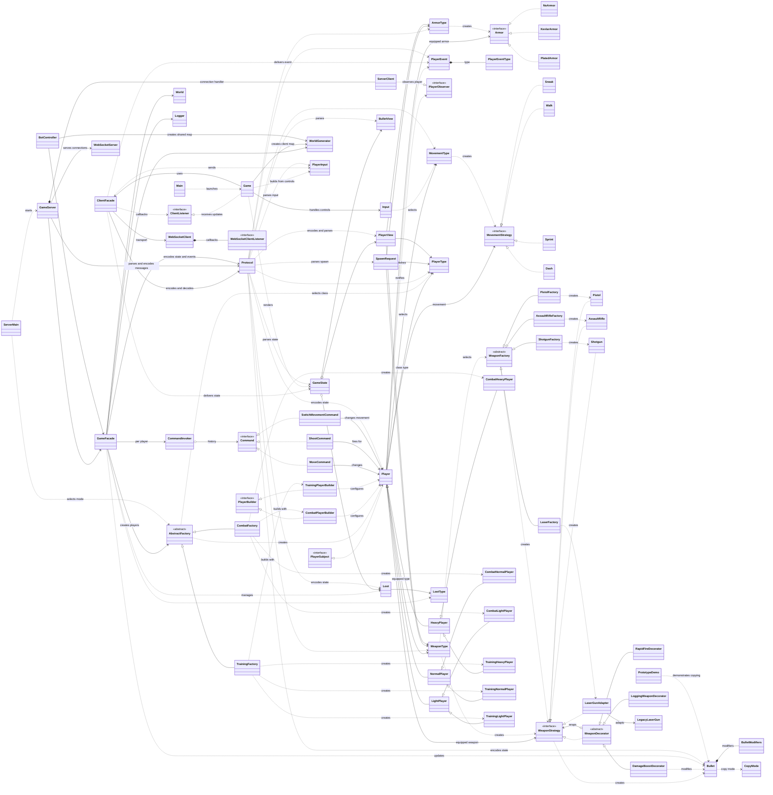

# Opp Shooter class diagram

This diagram includes the program's classes, interfaces, enums, records, and nested types across
packages. The `game` package contains the runtime, while the other packages implement the design
patterns used by it.

Solid inheritance arrows show class extension; dashed inheritance arrows show interface
implementation; composition and association arrows show fields or collaboration. `ServerClient`,
`ClientListener`, `WebSocketClientListener`, `SpawnRequest`, and `PlayerEventType` represent nested
types (`GameServer.Client`, `ClientFacade.Listener`, `WebSocketClient.Listener`,
`Protocol.SpawnRequest`, and `PlayerEvent.Type`).
