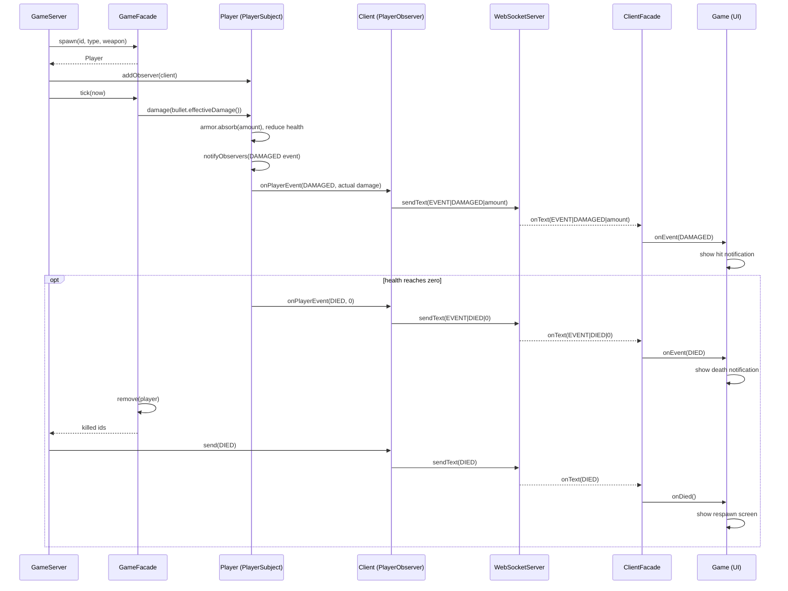

# Game design patterns

Every pattern lives in its own Java package. Non-pattern code (map, loot, Swing client, WebSocket
code, `GameServer`, `BotController`) is in package `game`. The repository has no demo or test
classes; the outputs quoted below were captured from throwaway demo runs of the classes described.

| Requirement | Package | Implementation and evidence |
| --- | --- | --- |
| a. Singleton, thread-safe | `singleton` | `Logger`; a 200-thread run saw one instance (see below). |
| b. Factory, 3+ classes | `factory` | `PlayerFactory.forType` → `HeavyPlayerFactory`, `NormalPlayerFactory`, `LightPlayerFactory`; `WeaponFactory`. |
| c. Abstract Factory, 2+ factories × 3 classes | `abstractfactory` | abstract class `AbstractFactory`; `CombatFactory` and `TrainingFactory` each produce 3 player classes. |
| d. Strategy, 4+ classes | `strategy` | `Sneak`, `Walk`, `Sprint`, `Dash` (`MovementStrategy`); `Pistol`, `AssaultRifle`, `Shotgun` (`WeaponStrategy`). |
| e. Observer, sequence diagram | `observer` | `PlayerSubject`, `PlayerObserver`, `PlayerEvent`; diagram below. |
| f. Builder, 2+ concrete builders | `builder` | `PlayerBuilder`; `CombatPlayerBuilder`, `TrainingPlayerBuilder`. |
| g. Adapter, different method counts | `adapter` | `LaserGunAdapter` (4-method `WeaponStrategy`) wraps `LegacyLaserGun` (5 methods). |
| h. Prototype, deep vs shallow, addresses | `prototype` | `Bullet`, `BulletModifiers`, `CopyMode`; identity hashes of the copies are listed below. |
| i. Decorator, 3+ levels | `decorator` | `Logging(DamageBoost(RapidFire(Pistol)))`. |
| j. Command with `undo()` | `command` | `MoveCommand`, `ShootCommand`, `SwitchWeaponCommand`, `SwitchMovementCommand`; `CommandInvoker`. |
| k. Facade, 2+ clients, 3+ subsystems | `facade` | `GameFacade` (server side) with clients `game.GameServer` and `game.BotController`; `ClientFacade` (client side) hides the connection; details below. |
| l. Bridge, 2+ abstractions, 2+ implementations | `bridge` | `Player` → `HeavyPlayer`/`NormalPlayer`/`LightPlayer`; `Armor` → `NoArmor`/`KevlarArmor`/`PlatedArmor`. |

`Player`, `PlayerType` and the three player classes are in `bridge` because they are the Bridge
abstraction. `Bullet` is in `prototype`. State they expose (`Player.health`, `Bullet.damage`, ...)
is public so the other packages can use it.

## Singleton

`Logger` is created by a `static final` field initializer. The JVM runs class initialization exactly
once under a lock, so no thread can see two instances or a half-built one; `log` is `synchronized`
so concurrent lines never interleave. A run that started 200 threads behind a latch, released them
together, and checked the result gave:

```text
Threads released simultaneously: 200
Distinct Logger instances seen:  1 (identity 4af0c6a9)
Log lines written / intact:      200 / 200
PASS: one instance, no interleaved output
```

## Prototype

`Bullet implements Cloneable`; its nested `BulletModifiers` (`damageBonus`) is the
reference field whose copying differs between modes.

- `shallowCopy()` is `super.clone()`: the copy **shares** the `BulletModifiers`.
- `deepCopy()` is `shallowCopy()` plus `modifiers.copy()`: the copy owns its own.
- `copy(id, ownerId, x, y, angle)` uses the static, runtime-switchable
  `Bullet.getCopyMode()` / `setCopyMode()` (default `DEEP`), then sets id, owner, position,
  `alive = true`, and velocity from `angle × hypot(vx, vy)`.
- `effectiveDamage()` = `damage + modifiers.getDamageBonus()`; the server applies it on hit.

Captured output for `DEEP` (the identity hashes differ per run):

```text
Copy mode used by Bullet.copy(): DEEP
-- before mutation
original  bullet=3f99bd52 modifiers=4f023edb effectiveDamage=30
shallow   bullet=33c7353a modifiers=4f023edb effectiveDamage=30
deep      bullet=681a9515 modifiers=3af49f1c effectiveDamage=30
copy()    bullet=19469ea2 modifiers=13221655 effectiveDamage=30
-- after shallow.modifiers().setDamageBonus(99)
original  bullet=3f99bd52 modifiers=4f023edb effectiveDamage=124
shallow   bullet=33c7353a modifiers=4f023edb effectiveDamage=124
deep      bullet=681a9515 modifiers=3af49f1c effectiveDamage=30
copy()    bullet=19469ea2 modifiers=13221655 effectiveDamage=30
```

The shallow copy has the original's `modifiers` hash, so mutating it changes the original
(30 → 124). The deep copy has its own hash and stays at 30. With `SHALLOW`, the `copy()` row
shares the original's modifiers hash and also changes to 124.

## Bridge

Abstraction: `Player` holds an `Armor` (`getArmor` / `setArmor`, default `NoArmor`) and
applies `amount = armor.absorb(amount)` in `damage()`. Refined abstractions: `HeavyPlayer`,
`NormalPlayer`, `LightPlayer`. Implementors: `NoArmor` (100% passes through), `KevlarArmor`
(75%), `PlatedArmor` (50%); results round up, so a hit never becomes 0. The two hierarchies
vary independently (a 40-point hit):

```text
              None            Kevlar          Plated
HeavyPlayer   40 (80/120)     30 (90/120)     20 (100/120)
NormalPlayer  40 (60/100)     30 (70/100)     20 (80/100)
LightPlayer   40 (40/80)      30 (50/80)      20 (60/80)
```

Cells are damage taken (HP left / max HP).

**Bridge vs Strategy vs Adapter**

| | Bridge | Strategy | Adapter |
| --- | --- | --- | --- |
| Intent | Split an abstraction from its implementation so **both hierarchies** grow independently (3 player classes × 3 armors, not 9 subclasses). | Make **one algorithm** of a context swappable at runtime. | Make an **existing, incompatible** class usable through the interface a client expects. |
| Structure | Abstraction (`Player`) holds an implementor (`Armor`); the abstraction itself has refined subclasses. | Context holds a strategy; the context has no hierarchy of its own that varies with the strategy. | Adapter implements the target and wraps the adaptee. |
| When decided | Up front, at design time. | Up front, to allow runtime swapping. | After the fact, because the adaptee already exists and cannot change. |
| Here | `Player`/`Armor`: the armor is chosen by the builder and class and armor vary separately. | `Player`/`MovementStrategy`: movement is swapped whenever the client's key changes. | `LaserGunAdapter`/`LegacyLaserGun`: a legacy 5-method API presented as a 4-method `WeaponStrategy`. |

In short: Strategy swaps behaviour behind one interface, Adapter converts one interface into another,
and Bridge keeps two independently varying dimensions from multiplying into a class explosion.

## Decorator

`WeaponStrategy` is the component; `WeaponDecorator` holds `protected final WeaponStrategy
wrappee` and delegates all four methods. `LoggingWeaponDecorator` logs through
`Logger.getInstance()` before and after `fire`; `RapidFireDecorator` halves
`shootingDelay()`; `DamageBoostDecorator` adds 10 to the damage of every bullet it returns.
Wrapping a `Pistol` in three decorators, one level at a time, gave:

```text
level  weapon                                              delay  damage
0      Pistol                                              325 ms    25
1      RapidFire(Pistol)                                   162 ms    25
2      DamageBoost(RapidFire(Pistol))                      162 ms    35
3      Logging(DamageBoost(RapidFire(Pistol)))             162 ms    35
```

## Abstract Factory

```java
abstract class AbstractFactory {
    abstract Player createHeavy(int id, double x, double y);
    abstract Player createNormal(int id, double x, double y);
    abstract Player createLight(int id, double x, double y);
    Player create(PlayerType t, int id, double x, double y) { /* switch on t */ }
}
```

| Factory | Heavy | Normal | Light | Behaviour |
| --- | --- | --- | --- | --- |
| `CombatFactory` | `CombatHeavyPlayer` | `CombatNormalPlayer` | `CombatLightPlayer` | same as the base classes |
| `TrainingFactory` | `TrainingHeavyPlayer` | `TrainingNormalPlayer` | `TrainingLightPlayer` | `damage()` never takes health below 1 |

## Builder

`PlayerBuilder` steps: `start(Player)`, `addWeapon(WeaponType)`, `addArmor()`,
`addMovement()`, `addAmmo()`, `build()`. The first five return the builder; `build()` returns
the finished `Player`. Both builders implement every step differently:

| Step | `CombatPlayerBuilder` | `TrainingPlayerBuilder` |
| --- | --- | --- |
| weapon | plain weapon from `WeaponFactory` | `LoggingWeaponDecorator(weapon)` |
| armor | `KevlarArmor` | `PlatedArmor` |
| movement | `Walk` | `Sneak` |
| ammo | 60 | 999 |

```java
Player p = builder.start(factory.create(type, id, x, y))
        .addWeapon(w).addArmor().addMovement().addAmmo().build();
```

## Adapter

Target `WeaponStrategy`; adaptee `LegacyLaserGun` with an incompatible API;
adapter `LaserGunAdapter`. `WeaponFactory` maps `WeaponType.LASER` to
`new LaserGunAdapter(new LegacyLaserGun())`.

| `WeaponStrategy` (target, 4 methods) | `LegacyLaserGun` (adaptee, 5 methods) | Adapter mapping |
| --- | --- | --- |
| `shootingDelay()` | `rechargeTimeMs()` (400) | `(int) rechargeTimeMs()` |
| `bulletCount()` | – | constant 1 |
| `bulletPrototype()` | `beamSpeed()` (18), `beamDamage()` (35) | `Bullet` built from both |
| `fire(player, angle, ids)` | `chargeCapacitor()`, `isCharged()` | charge; if charged, return 1 bullet |

## Command

`Command { String execute(); String undo(); }`, receiver `Player`.

| Command | `execute` | `undo` |
| --- | --- | --- |
| `MoveCommand` | saves x, y; `player.move(...)` | restores x, y |
| `ShootCommand` | saves ammo, lastShot; fires into `out` | restores both; fired bullets get `alive = false` |
| `SwitchWeaponCommand` | saves previous type + strategy; `setWeapon` | re-equips the saved pair |
| `SwitchMovementCommand` | saves previous type + strategy; `setMovement` | re-equips the saved pair |

`CommandInvoker` keeps a `Deque<Command>` capped at 100: `run` executes and pushes, `undo`
pops and undoes. `GameFacade` gives every spawned player its own invoker. Each tick it
runs the switch commands only when the requested value differs from the player's current
one, a `MoveCommand` while a direction key is held, and a `ShootCommand` while the fire button is
held and the weapon is ready. Running each command and then undoing it gave:

```text
  [start                     ] position=(200.0, 200.0) ammo=60 ... liveBullets=0
  [run  MoveCommand          ] position=(203.2, 200.0) ammo=60 ... liveBullets=0
  [undo                      ] position=(200.0, 200.0) ammo=60 ... liveBullets=0
  [run  ShootCommand         ] position=(200.0, 200.0) ammo=59 ... liveBullets=1
  [undo                      ] position=(200.0, 200.0) ammo=60 ... liveBullets=0
```

## Facade

Two facades simplify the client-server boundary, one per side. Neither side builds or splits
protocol strings itself: both go through `facade.Protocol`, which holds every message format.

### Server side: `GameFacade`

`GameFacade(AbstractFactory, PlayerBuilder)` hides `World`, `WorldBuilder`, the factory and
builder, per-player `CommandInvoker`s, bullets, loot and `Logger`:

| Method | Does |
| --- | --- |
| `spawn(id, PlayerType, WeaponType)` | finds a free position, creates via the factory, equips via the builder |
| `applyInput(id, PlayerInput, now)` | one tick of a player's held input, as commands; then loot pickup |
| `tick(now)` | timed loot spawning, bullet movement and hits; returns ids killed this tick |
| `stateMessage()` | the `STATE\|...` protocol line (encoded by `Protocol.state`) |
| `remove(id)` | drops a player on death or disconnect |
| `players()`, `hasPlayer(id)`, `worldSeed()` | read-only queries |

**Clients (2):** `game.GameServer` (feeds it network input) and `game.BotController` (feeds it
bot input). Both use the same methods.

**Subsystems (5):** `game.World` (map, walls, loot), `abstractfactory.AbstractFactory`,
`builder.PlayerBuilder`, `command.CommandInvoker` (one per player), and `singleton.Logger`; bullets are
kept inside the facade.

`GameServer` keeps only sockets and threads.

### Client side: `ClientFacade`

`new ClientFacade(host, port, listener)` hides the `WebSocketClient` transport (handshake, frames,
reader thread) and `Protocol` decoding. The Swing `Game` calls a few methods and implements one
listener:

| Call | Does |
| --- | --- |
| `connect()` / `close()` | opens or closes the WebSocket connection |
| `spawn(PlayerType, WeaponType)` | sends `SPAWN\|TYPE\|WEAPON` |
| `sendInput(PlayerInput)` | sends `INPUT\|...` |

| `ClientFacade.Listener` callback | Message |
| --- | --- |
| `onWelcome(playerId, worldSeed)` | `WELCOME` |
| `onSpawned()` / `onDied()` | `SPAWNED` / `DIED` |
| `onEvent(PlayerEvent)` | `EVENT` |
| `onState(GameState)` | `STATE`, decoded into `PlayerView`, `BulletView` and `Loot` records |
| `onDisconnected()` | connection closed |

`Game` no longer contains a single protocol string.

### Training mode

`java game.ServerMain --training [port]` builds the server facade with `TrainingFactory` +
`TrainingPlayerBuilder` (players cannot die, plated armor, 999 ammo, logged shots) and starts a
`BotController` with 2 bots. Without the flag it uses `CombatFactory` + `CombatPlayerBuilder` and no bots.

The bots have the reserved ids -1 and -2 and are ordinary players inside the facade. Every tick each bot
finds the closest living human, computes a breadth-first route over the map (rebuilt from the shared
seed, like a client does), and walks toward it until it is 60 px away. If no human is connected they idle.
Bots do not shoot.

## Observer

`PlayerSubject` declares `addObserver`, `removeObserver` and `notifyObservers(PlayerEvent)`;
`Player` implements it. Observers register with `addObserver` and unsubscribe with
`removeObserver`. State changes create typed `PlayerEvent` values; the server's
`GameServer.Client` implements `PlayerObserver` and forwards them over WebSocket, and
`ClientFacade` delivers them to `Game.onEvent` as HUD notifications.



Damage events precede death events. The separate `DIED` protocol message controls the
respawn screen. Loot, health pickup, and empty ammo also publish events. The observer list
is a `CopyOnWriteArrayList`, and callbacks run synchronously on the publisher's thread.

## Class diagram

```mermaid
classDiagram
    AbstractFactory <|-- CombatFactory
    AbstractFactory <|-- TrainingFactory
    HeavyPlayer <|-- CombatHeavyPlayer
    HeavyPlayer <|-- TrainingHeavyPlayer
    NormalPlayer <|-- CombatNormalPlayer
    NormalPlayer <|-- TrainingNormalPlayer
    LightPlayer <|-- CombatLightPlayer
    LightPlayer <|-- TrainingLightPlayer
    Player <|-- HeavyPlayer
    Player <|-- NormalPlayer
    Player <|-- LightPlayer
    Player --> Armor : bridge
    Armor <|.. NoArmor
    Armor <|.. KevlarArmor
    Armor <|.. PlatedArmor
    PlayerSubject <|.. Player
    Player --> MovementStrategy
    Player --> WeaponStrategy
    MovementStrategy <|.. Sneak
    MovementStrategy <|.. Walk
    MovementStrategy <|.. Sprint
    MovementStrategy <|.. Dash
    WeaponStrategy <|.. Pistol
    WeaponStrategy <|.. AssaultRifle
    WeaponStrategy <|.. Shotgun
    WeaponStrategy <|.. LaserGunAdapter
    LaserGunAdapter --> LegacyLaserGun
    WeaponStrategy <|.. WeaponDecorator
    WeaponDecorator o-- WeaponStrategy : wrappee
    WeaponDecorator <|-- LoggingWeaponDecorator
    WeaponDecorator <|-- RapidFireDecorator
    WeaponDecorator <|-- DamageBoostDecorator
    PlayerBuilder <|.. CombatPlayerBuilder
    PlayerBuilder <|.. TrainingPlayerBuilder
    Command <|.. MoveCommand
    Command <|.. ShootCommand
    Command <|.. SwitchWeaponCommand
    Command <|.. SwitchMovementCommand
    CommandInvoker o-- Command : history
    GameFacade --> AbstractFactory
    GameFacade --> PlayerBuilder
    GameFacade --> CommandInvoker
    GameServer --> GameFacade
    BotController --> GameFacade
    GameFacade --> Protocol
    Game --> ClientFacade
    ClientFacade --> Protocol
    ClientFacade --> WebSocketClient
```



## Running it

Compile everything into one output directory (Git Bash, from the project directory):

```bash
javac --release 17 -d out $(find . -name "*.java" -not -path "./out/*")
java -cp out game.ServerMain --training   # or without the flag for combat mode
java -cp out game.Main                    # one or more clients
```

In training mode two bots (ids -1 and -2) walk toward the closest player around walls and stop next to it.
