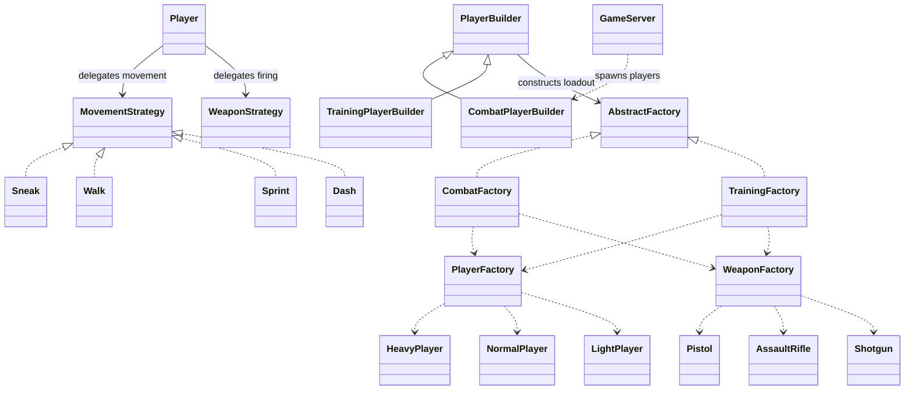
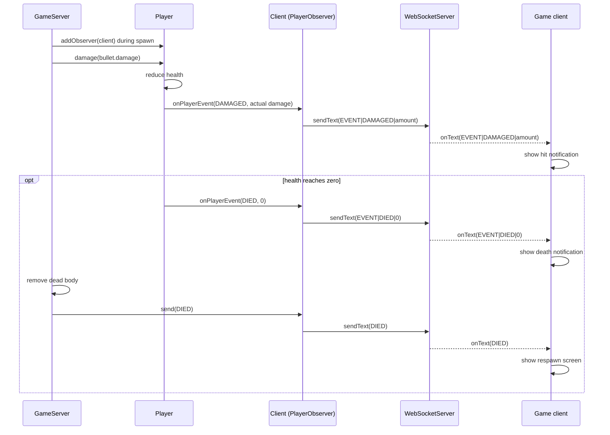

# Game design patterns

This implementation follows the requested player, weapon, movement, and builder
structure. The runnable `DesignPatternsDemo` shows each pattern and checks its
behavior. `HeavyPlayer.java` is the Heavy product; `WeaponStrategy.java` remains
the firing contract for weapon products. The four required Strategy classes
implement the separate `MovementStrategy` contract.

| Requirement | Implementation |
| --- | --- |
| b. Factory: at least 3 classes in a family | Player family: `HeavyPlayer`, `NormalPlayer`, `LightPlayer`. Weapon family: `Pistol`, `AssaultRifle`, `Shotgun`. |
| c. Abstract Factory: at least 2 real factories, 3 classes in each family | `CombatFactory` and `TrainingFactory` implement `AbstractFactory`. Each produces a player, weapon, and movement strategy; both support all three player and weapon classes. |
| d. Strategy: at least 4 classes | `Sneak`, `Walk`, `Sprint`, `Dash` implement `MovementStrategy`. |
| e. Observer demonstrated with sequence diagram | `Player` publishes `PlayerEvent` to `PlayerObserver`; the server's `Client` subscriber forwards events to the game HUD. Diagram below. |
| f. Builder: at least 2 concrete builders | `CombatPlayerBuilder` and `TrainingPlayerBuilder` extend `PlayerBuilder`, accepting `PlayerType` and `WeaponType`. |

## Factory

`PlayerFactory.forType(type)` chooses a creator. Its `createPlayer` factory
method returns the corresponding concrete player without the caller constructing
that subclass. The three concrete creators are `HeavyPlayerFactory`,
`NormalPlayerFactory`, and `LightPlayerFactory`.

Normal's baseline speed is 3.2 units per server tick:

| Product | HP | Class speed | Units per tick while walking |
| --- | --- | --- | --- |
| `HeavyPlayer` | 120 | 80% | 2.56 |
| `NormalPlayer` | 100 | 100% | 3.20 |
| `LightPlayer` | 80 | 120% | 3.84 |

`WeaponFactory.createWeapon(type)` creates one of these three concrete weapons:

| Product | Delay between shots | Bullets / ammo per shot |
| --- | --- | --- |
| `Pistol` | 325 ms | 1 |
| `AssaultRifle` | 130 ms | 1 |
| `Shotgun` | 650 ms | 3 |

The shotgun emits a center bullet and two side bullets. Each side's angle is
randomly sampled between 3 and 15 degrees from the aim direction, one on each
side. All three bullets have unique IDs and consume three rounds together.
The existing bullet speed (9) and base damage (25) are preserved.

```java
Player heavy = PlayerFactory.forType(PlayerType.HEAVY).createPlayer(1, 200, 200);
WeaponStrategy shotgun = new WeaponFactory().createWeapon(WeaponType.SHOTGUN);
```

`WeaponType.createStrategy` delegates to `WeaponFactory`, so existing callers
also use the new factory.

## Abstract Factory

`AbstractFactory` defines three related products: player, weapon, and movement
strategy. The concrete factories compose the requested `PlayerFactory` and
`WeaponFactory`. Two complete loadout factories are provided so the implementation
also demonstrates creating related product families through one interface.

| Real factory | Default player class | Default weapon class | Default movement class |
| --- | --- | --- | --- |
| `CombatFactory` | `NormalPlayer` | `AssaultRifle` | `Walk` |
| `TrainingFactory` | `LightPlayer` | `Pistol` | `Sneak` |

Each row contains three concrete product classes. Both real factories can also
create all `HeavyPlayer`, `NormalPlayer`, and `LightPlayer` products, and all
`Pistol`, `AssaultRifle`, and `Shotgun` products when the caller supplies a type.
Their default recipes and movement products distinguish the loadout families.

```java
AbstractFactory factory = new TrainingFactory();
Player player = factory.createPlayer(factory.defaultPlayerType(), 1, 200, 200);
player.equipWeapon(factory.defaultWeaponType(), factory.createWeapon(factory.defaultWeaponType()));
player.equipMovement(factory.defaultMovementType(), factory.createMovement());
```

## Strategy

`Player` is the context and holds the current `MovementStrategy`. `setMovement`
switches its strategy. `move` normalizes the input direction, multiplies the
class speed by the strategy's multiplier, and checks collisions in small steps.
This keeps diagonal speed consistent and prevents faster movement from skipping
walls.

| Concrete strategy | Multiplier of class speed | Control |
| --- | --- | --- |
| `Sneak` | 0.5 | Hold Ctrl |
| `Walk` | 1.0 | WASD without a movement modifier |
| `Sprint` | 1.5 | Hold Shift |
| `Dash` | 3.0 during its burst, then 1.0 | Hold Space |

Dash lasts 150 ms and has a 1000 ms cooldown measured from its start. Holding
Space triggers another burst when the cooldown ends and the player is moving.
Standing still does not consume a dash. Cooldown timestamps belong to the
player, so releasing Space or switching strategies cannot reset the cooldown.
Input priority is Space, then Ctrl, then Shift, then Walk.

For a Normal player, the four speeds are 1.6, 3.2, 4.8, and 9.6 units per tick.
For Heavy and Light, the same movement multipliers apply to their class speeds.

```java
player.setMovement(MovementType.SPRINT);
player.move(false, false, false, true, world, now); // right
```

The client appends the movement enum to input snapshots. The server applies the
strategy and owns dash timing. Old eight-field INPUT messages remain accepted
and select Walk; the new ninth field contains SNEAK, WALK, SPRINT, or DASH.
Invalid movement values are ignored along with that input message.

## Builder

`PlayerBuilder` defines the common construction steps: player type, weapon type,
identity, position, and `build`. The two concrete builders choose their respective
Abstract Factory and default recipe:

| Concrete builder | Factory | Default constructed loadout |
| --- | --- | --- |
| `CombatPlayerBuilder` | `CombatFactory` | Normal + Assault Rifle + Walk |
| `TrainingPlayerBuilder` | `TrainingFactory` | Light + Pistol + Sneak |

Both accept any combination of the three player types and three weapon types:

```java
Player player = new CombatPlayerBuilder()
        .playerType(PlayerType.HEAVY)
        .weaponType(WeaponType.SHOTGUN)
        .identity(42)
        .position(200, 200)
        .build();

Player trainee = new TrainingPlayerBuilder().identity(43).position(400, 200).build();
```

Each call creates a new player, weapon prototype, and movement strategy. Health,
ammo, shot timers, observer subscriptions, and dash cooldown are independent.
`GameServer.spawnPlayer` uses `CombatPlayerBuilder` with the spawn screen's
selected types; it retries positions until the player's collision radius fits.
Training construction is available through its builder API and the demonstration.



## Observer sequence diagram

`Player` is the subject. Observers register with `addObserver` and unsubscribe
with `removeObserver`. State changes create typed `PlayerEvent` values. The
server's `GameServer.Client` implements `PlayerObserver` and forwards events
over WebSocket. `Game.onText` converts them to HUD notifications.



Damage events precede death events. The separate `DIED` protocol message controls
the respawn screen. Loot, health pickup, and empty ammo also publish events.
The observer list is a `CopyOnWriteArrayList`, and callbacks run synchronously
on the publisher's thread. The demo shows two subscribers receiving the same
events, then removes one and verifies it receives no subsequent pickup event.

## Demonstration and verification

From the project directory in PowerShell:

```powershell
$sources = @(Get-ChildItem *.java | ForEach-Object FullName) + @(Get-ChildItem tests/*.java | ForEach-Object FullName)
javac --release 17 -d out/tests $sources
java -cp out/tests DesignPatternsDemo
java '-Djava.awt.headless=true' -cp out/tests PlayerFactoryTest
java '-Djava.awt.headless=true' -cp out/tests GameplayTest
java '-Djava.awt.headless=true' -cp out/tests DesignPatternsTest
java '-Djava.awt.headless=true' -cp out/tests LootTest
java '-Djava.awt.headless=true' -cp out/tests MovementStrategyTest
```

The demo and all five test programs passed. Tests cover the three player stat
sets, weapon cooldowns/projectile counts/spread/ammo, both builders and all nine
class/weapon combinations, observer delivery/removal, movement normalization
and wall collisions, dash timing boundaries and cooldown retention, keyboard
priority, WebSocket movement selection, and legacy input compatibility.

Selected demonstration output:

```text
PlayerFactory: HeavyPlayer -> 120 HP, speed 2.56
PlayerFactory: NormalPlayer -> 100 HP, speed 3.20
PlayerFactory: LightPlayer -> 80 HP, speed 3.84
AbstractFactory: CombatFactory -> NormalPlayer + AssaultRifle + Walk
AbstractFactory: TrainingFactory -> LightPlayer + Pistol + Sneak
Strategy: Sneak -> 1.60 units/tick
Strategy: Walk -> 3.20 units/tick
Strategy: Sprint -> 4.80 units/tick
Strategy: Dash -> 9.60 units/tick
PASS: Factory, Abstract Factory, four movement Strategies, Observer, two concrete PlayerBuilders
```
