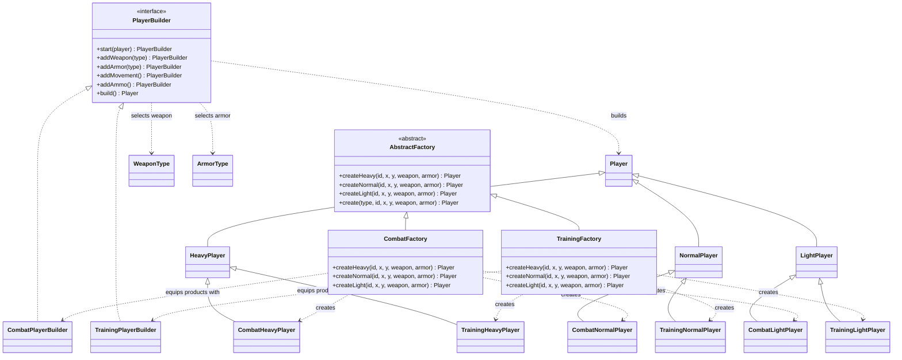

# Abstract factory UML class diagram

`CombatFactory` and `TrainingFactory` create families of player classes. Each factory builds one
heavy, normal, or light product and then uses its matching builder to equip it.

Both factories expose the same creation methods, but each returns products from its own family.
The combat builder equips a standard weapon, armor, walking movement, and 60 ammo. The training
builder equips a logging weapon, armor, sneaking movement, and 999 ammo; its player products also
cannot be reduced below 1 health.
