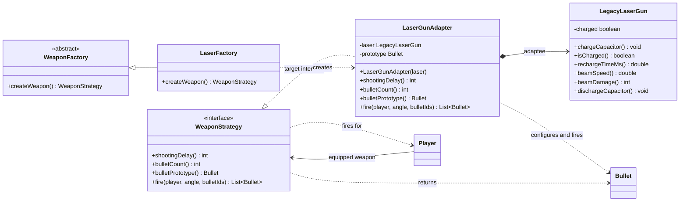

# Adapter UML class diagram

`LaserGunAdapter` implements the weapon interface expected by the game and delegates laser-specific
operations to the existing `LegacyLaserGun` API.

The adapter maps `rechargeTimeMs()` to `shootingDelay()` and uses `beamSpeed()` and `beamDamage()`
to initialize its bullet prototype. On `fire`, it charges and discharges the legacy capacitor,
then returns the projectile through the standard `WeaponStrategy` API.
