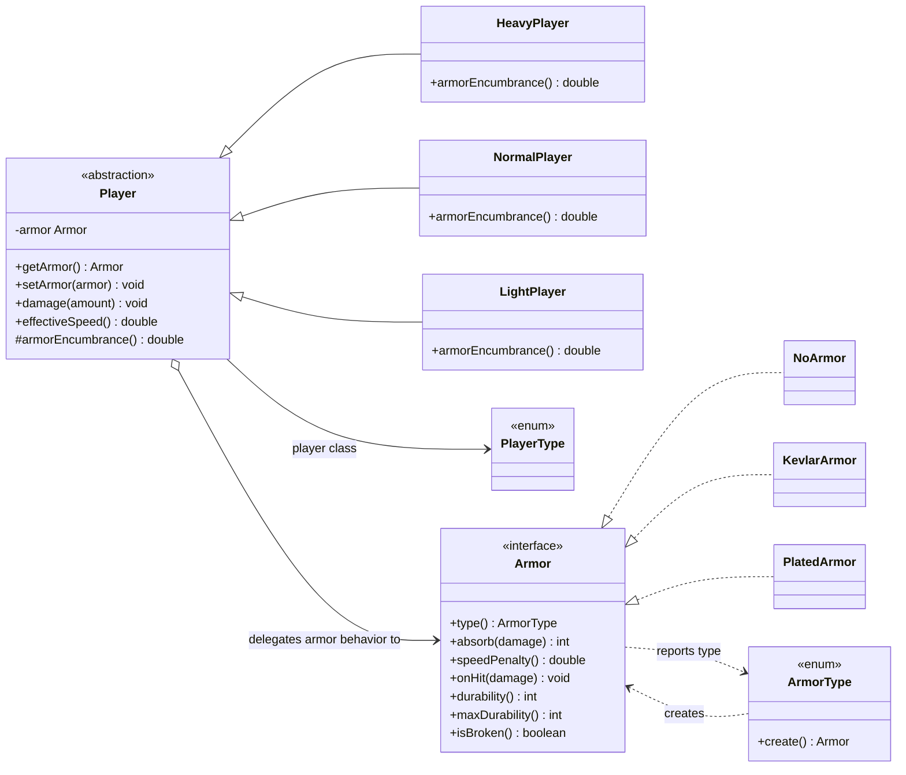

# Bridge UML class diagram

The `Player` abstraction delegates armor behavior to an `Armor` implementor. Player classes and
armor classes can vary independently; each player chooses an armor through `setArmor`.

`damage()` asks the selected armor how much damage passes through and then wears it down. The
player subclass also applies its own armor encumbrance when calculating movement speed: Heavy feels
none of the armor speed penalty, Normal feels all of it, and Light feels 1.5 times the penalty.
