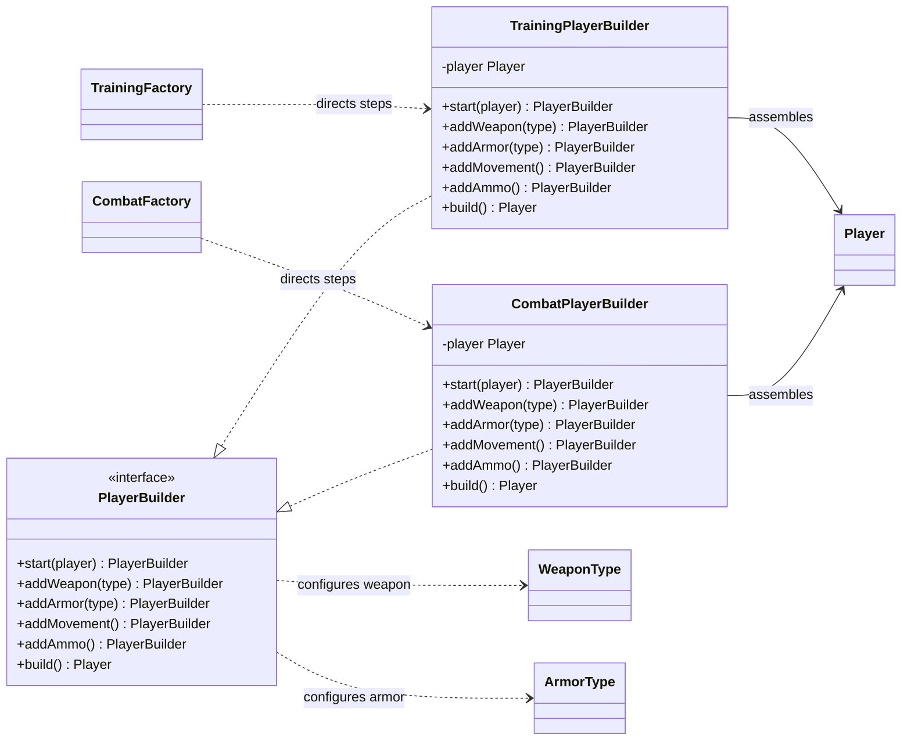

# Builder UML class diagram

The concrete abstract factories act as directors: each selects its product class, then calls the
same builder steps to assemble a `Player`. The combat and training builders give those steps
different meanings.

Each factory creates a fresh builder for one player and runs `start`, `addWeapon`, `addArmor`,
`addMovement`, `addAmmo`, and `build`. `CombatPlayerBuilder` equips walking movement and 60 ammo;
`TrainingPlayerBuilder` equips sneaking movement, 999 ammo, and a logging weapon decorator.
