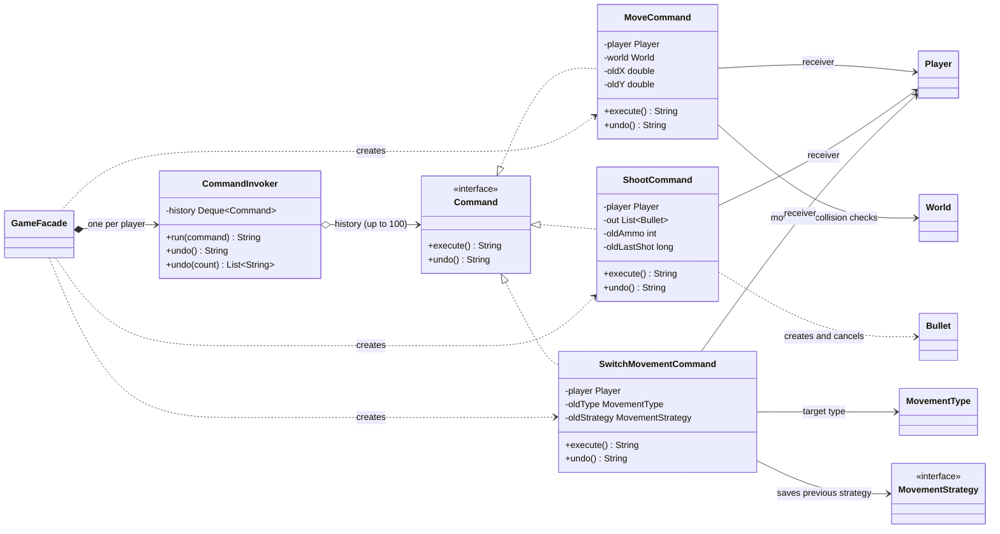

# Command UML class diagram

Each concrete command stores the state it needs to execute and undo one action on a `Player`.
`CommandInvoker` runs commands and keeps a bounded history for undo.

Undo runs newest first. `MoveCommand` restores position, `ShootCommand` restores ammo and shot time
and marks its bullets dead, and `SwitchMovementCommand` re-equips the previous movement type and
strategy.
