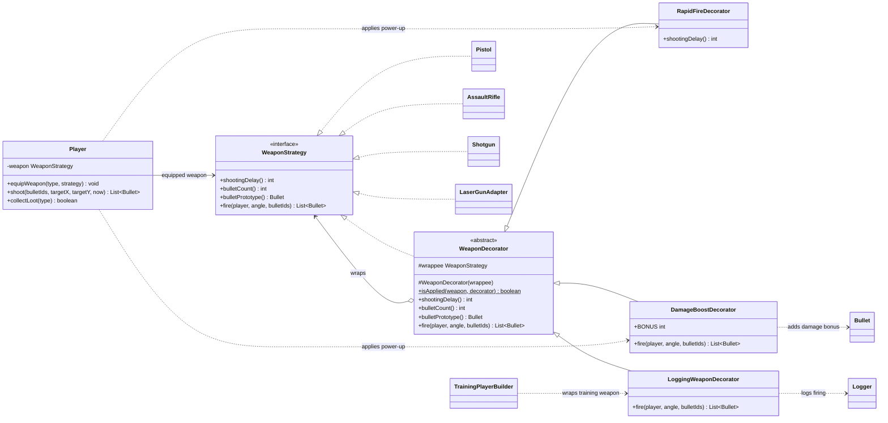

# Decorator UML class diagram

Each decorator implements the same `WeaponStrategy` interface as a weapon and wraps another
`WeaponStrategy`. This allows decorators to be stacked while a `Player` continues to use one
weapon interface.

The wrapped reference can itself be another decorator. For example,
`LoggingWeaponDecorator(DamageBoostDecorator(RapidFireDecorator(Pistol)))` remains a
`WeaponStrategy`. The decorators change firing delay, bullet damage, or logging while forwarding
the other weapon operations to the wrapped object.
