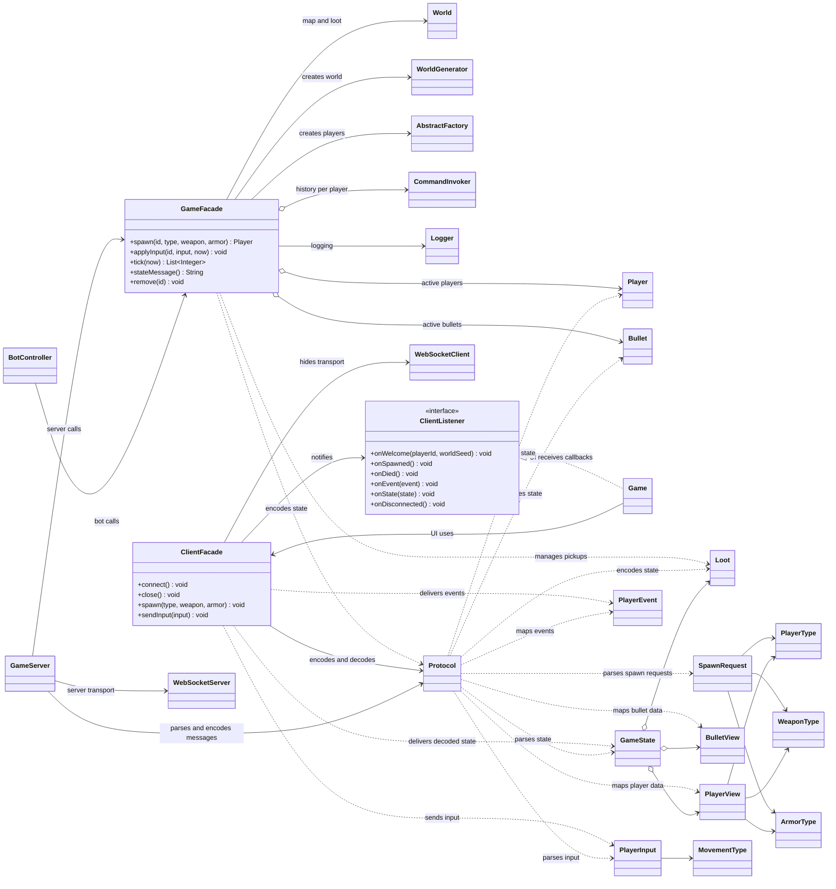

# Facade UML class diagram

The program has a server-side facade for game simulation and a client-side facade for the network
connection. Each gives its callers a smaller API over several subsystems.

`GameServer` and `BotController` use the same `GameFacade` operations. On the client, `Game` uses
`ClientFacade` and receives typed callbacks, so it does not manage WebSocket transport or protocol
parsing itself. `Protocol` centralizes the wire formats used on both sides.
