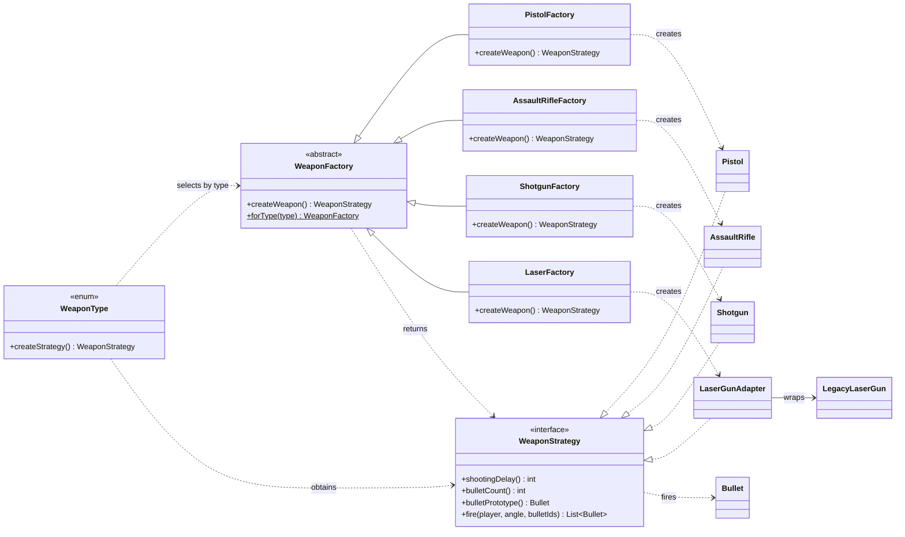

# Factory method UML class diagram

`WeaponFactory` defines the factory method. Each concrete factory chooses a weapon implementation,
and `WeaponType` selects which factory to use.

`CombatPlayerBuilder` and `TrainingPlayerBuilder` use `WeaponFactory.forType(type).createWeapon()`
when equipping a player. The laser product is a `LaserGunAdapter`, which presents the legacy laser
as a `WeaponStrategy`.
