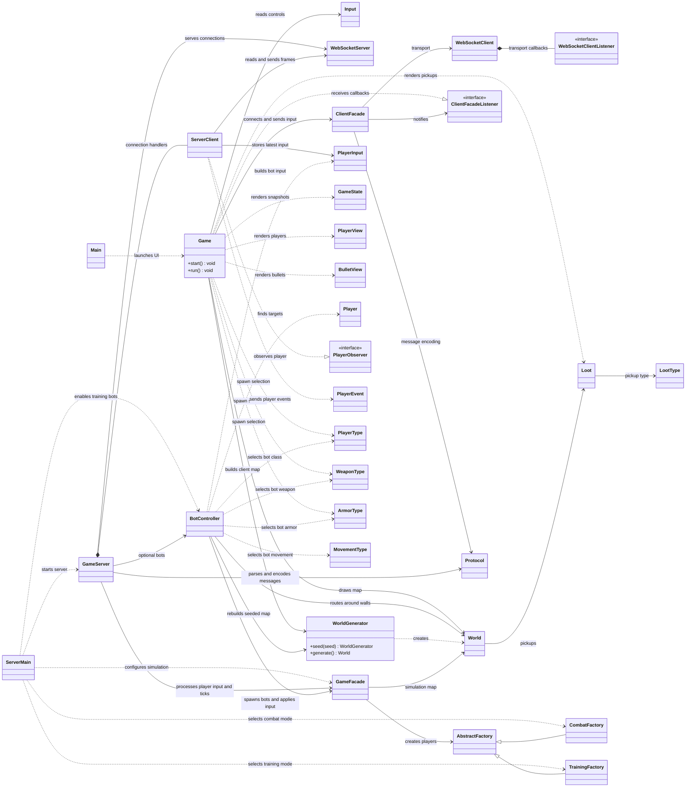

# Game package UML class diagram

This diagram shows the runtime classes in `game` and the main cross-package types they use for
simulation, networking, input, and rendering.

`ServerClient`, `ClientFacadeListener`, and `WebSocketClientListener` represent the nested types
`GameServer.Client`, `ClientFacade.Listener`, and `WebSocketClient.Listener`. `Main` launches the
Swing client; `ServerMain` selects combat or training configuration before starting `GameServer`.
