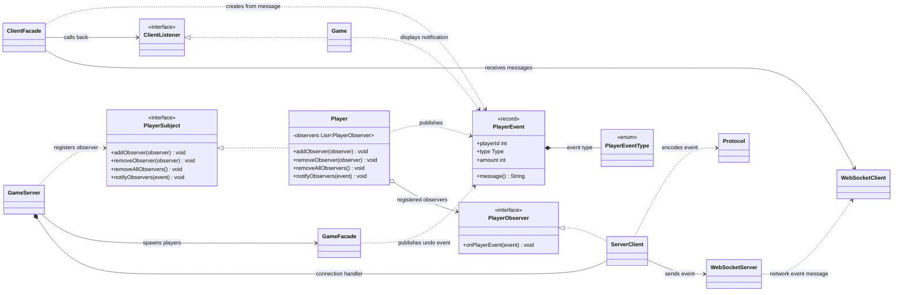

# Observer UML class diagram

`Player` publishes typed events to registered observers. The server's per-connection client
observes each spawned player and forwards those events to the remote UI.
See the [Observer sequence diagram](SEQUENCE_DIAGRAM.md) for the registration and event-delivery flow.

`ServerClient`, `ClientListener`, and `PlayerEventType` stand for the nested types
`GameServer.Client`, `ClientFacade.Listener`, and `PlayerEvent.Type`. A player registers its
connection observer after spawning; the observer serializes each event, and the client facade
delivers the decoded event to `Game`.
