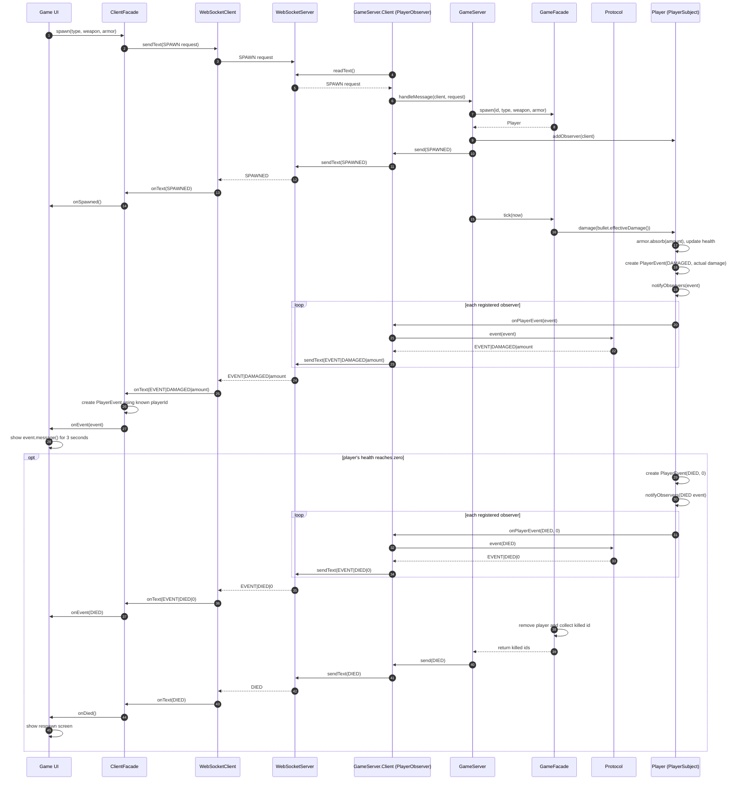

# Observer sequence diagram

`Player` is the subject and the spawned connection's `GameServer.Client` is its observer. The
diagram follows a bullet hit from registration through the HUD. The same notification route is used
for loot, health, power-up, empty-ammo, armor-break, and invalid-move events.

`Player.addObserver` runs after `GameFacade.spawn` returns the new player. `notifyObservers` iterates
the player's `CopyOnWriteArrayList` and invokes callbacks synchronously on the publishing thread.
`Player.damage` publishes `DAMAGED`, then `ARMOR_BROKEN` if armor just broke, then `DIED` if health
reached zero. `Player.collectLoot` and `Player.shoot` publish their corresponding events;
`GameFacade.rejectMove` publishes `UNDO_COMPLETED` directly. The wire event contains type and amount;
`ClientFacade` supplies the player id it learned from `WELCOME` when it reconstructs the `PlayerEvent`.

The `DIED` event is a HUD notification. After the facade reports killed ids, `GameServer` also sends
the separate `DIED` protocol message that opens the respawn screen.
