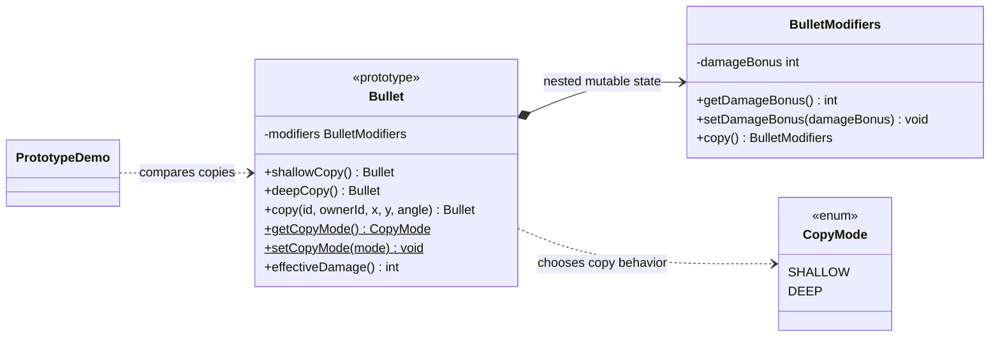

# Prototype UML class diagram

`Bullet` acts as its own prototype. It can make a shallow clone, a deep clone, or a fresh projectile
copy using the configured `CopyMode`.

`shallowCopy()` creates a new `Bullet` that shares the original's `BulletModifiers`. `deepCopy()`
also clones the modifiers, so changes to one copy do not affect the other. `copy()` selects between
those methods using `CopyMode`, then assigns the new projectile's identity, position, and velocity.
