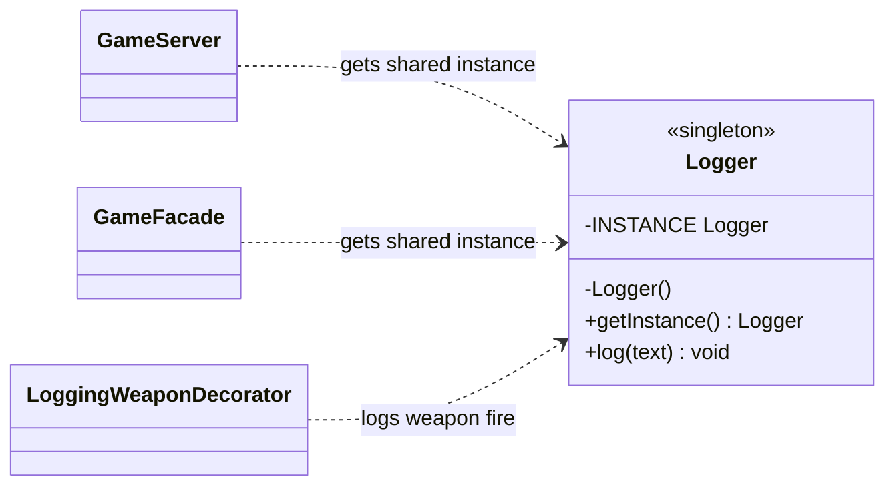

# Singleton UML class diagram

`Logger` exposes one shared instance through `getInstance()`. Its private constructor prevents
other classes from creating additional logger instances.

`INSTANCE` is initialized by the JVM during class initialization, which runs once. `log()` is
synchronized so concurrent calls do not interleave output lines.
