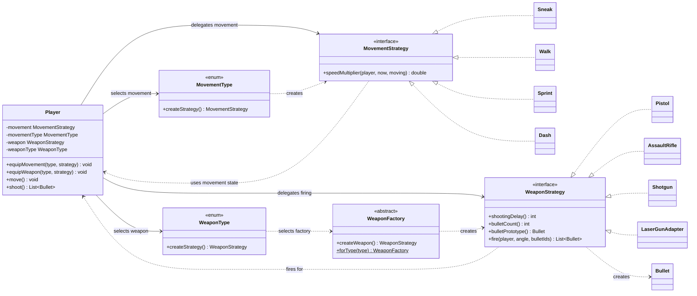

# Strategy UML class diagram

`Player` delegates two kinds of behavior to replaceable strategies: movement and weapon firing.
Each strategy interface has its own concrete implementations.

`MovementType` creates the selected movement strategy. `WeaponType` selects a factory, which creates
the corresponding weapon strategy. `LaserGunAdapter` also implements `WeaponStrategy`, allowing the
legacy laser to be equipped through the same interface.
